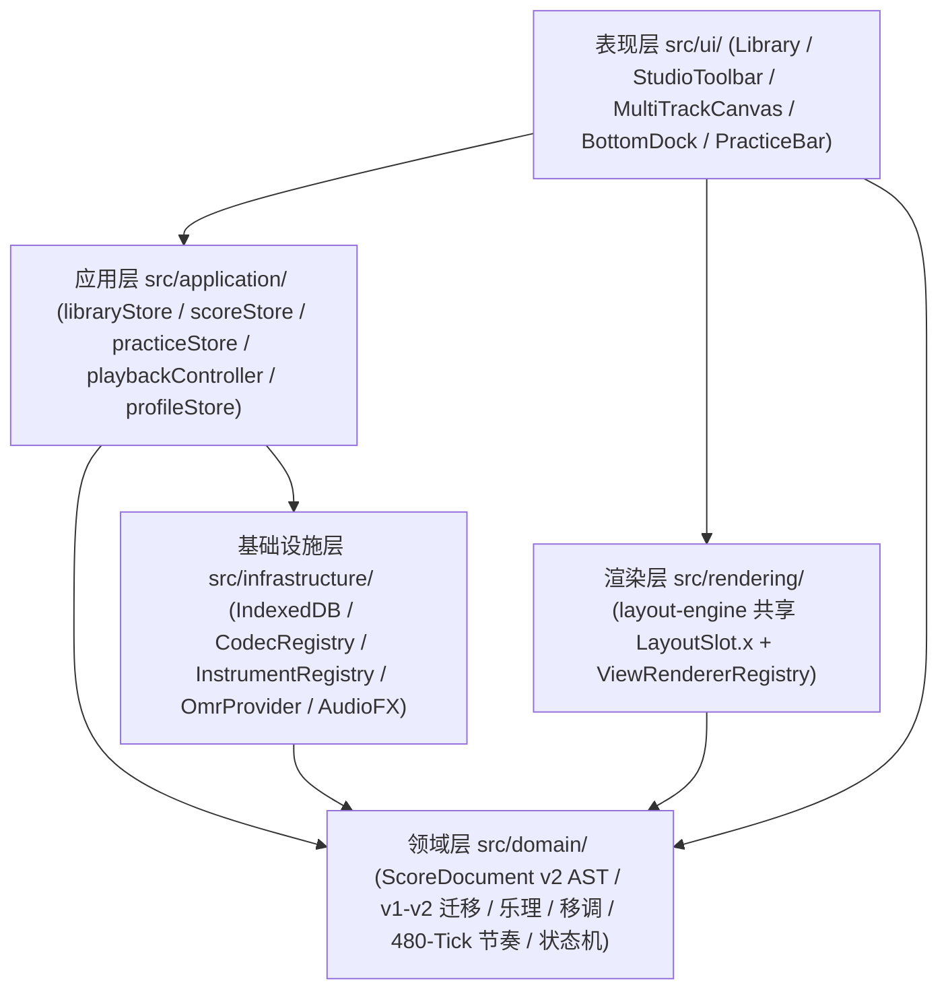

# 03 · NoteBridge（音桥）V2 演进需求与可扩展架构规划

> **文档属性**：V2 规划提案（尚未进入代码实施；P0 基线冻结文档 [01-范围与边界.md](01-范围与边界.md) 与 [02-架构与契约.md](02-架构与契约.md) 保持只读不变）  
> **编制日期**：2026-11-23  
> **参考输入**：来音制谱产品截图（乐谱库首页、制谱对照编辑页、会员权益页）+ 乐器化练谱场景（含电吉他、钢琴等）

---

## 一、V2 产品升级定位与对标分析

### 1.1 参考截图核心能力拆解

对照来音制谱的三张参考界面，其核心产品能力分为三层：

1. **乐谱库首页（Library）**：顶部搜索框 + 新建/导入卡片（`+`）+ 带缩略图与最近修改时间的曲谱网格列表。
2. **制谱对照编辑工作台**：
   - **顶部工具栏**：返回乐谱库、反馈/帮助、**原谱对照**（参考图片/PDF 与数字乐谱同屏核对）、**一键移调**、播放/暂停、设置、保存、导出/分享。
   - **中间专业谱面**：支持标题/副标题/词曲作者、多声部大谱表（高音+低音）、指法编号、连音线、反复记号、装饰音（`tr` 等）、三连音与渐强弱记号，且**去除了“来音制谱”居中水印**。
   - **底部多标签输入键盘**：可折叠/展开，按功能切分标签页：`键盘/音符`、`谱/调/拍/速`、`小节`、`线`、`歌词`、`指法`、`声部`；支持方向键移动光标、撤销/重做、删除与锁定游标步进模式。
3. **会员核心权益（V2 全部内置为免费/无付费墙能力）**：
   - 图片 / PDF 智能转谱（OMR）；
   - 一键移调；
   - 导出无水印高清排版；
   - 导出标准 MusicXML 格式；
   - 导出分谱（按乐器轨道/声部独立导出）。

### 1.2 NoteBridge V2 差异化定位

NoteBridge V2 在 **100% 保留 P0 简谱 ↔ 五线谱核心闭环** 的基础上，升级为 **“乐谱库首页 + 两大工作模式预设”** 的双引擎工作台：

1. **工作模式预设一：「制谱对照」模式**  
   聚焦制谱、编配、校对与格式互通：支持五线谱（单谱表 / 钢琴大谱表）、简谱、六线谱（TAB）自由组合对齐，支持原谱图像/PDF 对照纠错、多标签专业输入面板、一键移调、分谱导出与 MusicXML/PDF/PNG 无水印导出。
2. **工作模式预设二：「练谱」模式（可选乐器）**  
   聚焦看谱跟弹、慢速分解与伴奏练琴：进入练谱模式后可**选择目标乐器**（电吉他、木吉他、钢琴、电贝斯、通用单旋律/声乐），系统自动匹配对应谱面组合、专属演奏音色、底部实时指板/琴键高亮交互面板，以及 A–B 区间循环、预备拍、渐进提速、多轨消音与网页调音器等通用练琴工具。

---

## 二、会员权益级能力逐项落地方案（无付费墙、无水印）

| 序号 | 对标会员权益 | V2 开源本地化实现方案 | 关键边界与技术要点 |
|---|---|---|---|
| 1 | **一键移调** | 全曲按半音数（`-11..+11`）或目标调号移调，同步更新 `keySignature` 与全谱绝对音高 | • **简谱**：支持“保持首调唱名不变（仅换 `1=X`）”与“固定调音高移调”两种策略；<br>• **五线谱**：重算谱首调号与临时升降号；<br>• **吉他六线谱**：自动重算把位（优先最小把位移动）或联动**变调夹（Capo）**。 |
| 2 | **去除水印 & 高清导出** | 所有导出产物原生无水印，支持 **PNG 长图 / 分页图** 与 **A4 打印级矢量 PDF** | • PNG：基于主渲染层离屏序列化 SVG → 高 DPI Canvas 导出；<br>• PDF：采用 `jspdf` + `svg2pdf.js` 矢量直出，保留五线谱/简谱/六线谱清晰度，自动分页并支持渲染标题、副标题、词曲作者与页码（如 `2/6`）。 |
| 3 | **导出 / 导入 MusicXML** | 原生支持 `.musicxml` 与压缩 `.mxl`（`jszip` 解压/打包）双向转换 | • 打通与 MuseScore、Sibelius、Dorico、Finale 及来音制谱等软件的工程互通；<br>• 导入五线谱 MusicXML 后可直接转为简谱或六线谱对照查看。 |
| 4 | **导出分谱（Part Extraction）** | 针对多轨曲谱，支持勾选单个或多个 `Track`（如仅导出“主音电吉他”或“钢琴右手”）生成独立 PDF / PNG / MusicXML | • 分谱复用统一渲染管线，仅对选中轨道过滤布局并自动合并连续空白休止小节（后续可选项）。 |
| 5 | **图片 / PDF 智能转谱（OMR）与「原谱对照」** | **双层架构**：<br>1. **前端直接支持「原谱对照」**：任意曲谱可挂接原始图片 / PDF（本地读取，不上传外网），开启顶栏「原谱」开关即以分屏或浮动窗对照校对；<br>2. **可插拔 `OmrProvider` 识谱接口**：默认通过本地 Docker / Python 开源 OMR 桥接服务（如 `Audiveris` 或 `Homr`）或用户自配视觉 API Key 执行转谱，不设每日 10 页 / 每月 100 页限制 | • **架构边界诚实说明**：高精度纸质/PDF 光学乐谱识别（OMR）无法仅靠浏览器纯 JS 在 100% 离线条件下稳定完成；因此 V2 规范定义标准 `OmrProvider` 接口，前端内置「本地 OMR 服务适配器」与「原谱对照手录/导入修正」闭环，不绑死商业收费云服务。 |

---

## 三、信息架构与两大工作模式详细设计

### 3.1 入口层：乐谱库首页（Library）

- **顶部栏**：品牌标识、全局搜索框（按标题 / 作者 / 乐器标签过滤）、本地存储占用提示、全局设置入口。
- **操作卡片与列表**：
  - 首格固定为 **「+ 新建 / 导入乐谱」**（支持新建空白谱、从模板新建：电吉他单轨 / 电吉他乐队双轨 / 钢琴大谱表 / 简谱旋律、导入 MusicXML / MIDI / Guitar Pro / JSON / 简谱文本 / 图片PDF转谱）。
  - 曲谱卡片展示：第一页 SVG 自动缩略图、标题、修改日期、乐器徽标（如 `电吉他` / `钢琴` / `双谱`）、快捷操作（打开制谱 / 直接练谱 / 复制 / 删除）。
- **持久化升级**：从 P0 的 5MB `localStorage` 升级为 **IndexedDB**（通过 `Dexie` 或轻量原生封装），可长期存放几十首多轨曲谱及「原谱对照」图片/PDF 二进制附件；保留 `localStorage` v1 自动迁移逻辑，确保既有工程无损升级。

### 3.2 工作模式预设一：「制谱对照」模式

1. **顶部工具栏**
   - `返回乐谱库`、`原谱对照开关`（分屏显示上传的原图/PDF）、`一键移调`（弹窗选目标调号或半音偏移 + 吉他变调夹）、`播放试听`、`视图图层组合`、`撤销 / 重做`、`保存状态`、`导出中心`（无水印 PNG / PDF / MusicXML / 分谱 / WAV 音频）。
   - **工作模式切换器**：顶部右上角提供显眼胶囊开关 **`[ 制谱对照 | 练谱模式 ]`**，单点瞬时切换，底层共享同一份内存 `ScoreDocument`，不丢失光标与编辑历史。
2. **画布视图组合（勾选式图层，共享 `LayoutSlot.x`）**
   - 可按当前轨道自由勾选显示组合：`五线谱（高音 / 低音 / 钢琴大谱表）`、`简谱`、`六线谱（Guitar TAB）`。
   - 支持双谱或三谱同屏垂直对齐，复用单一布局引擎计算小节宽度与折行。
3. **底部专业制谱键盘（多标签折叠面板）**
   - 标签 1 **「录入」**：兼容现有简谱数字键盘（`1–7 / 0`、时值、临时升降、八度、附点）+ 音高/弦品快速切换；
   - 标签 2 **「谱/调/拍/速」**：调号（12 大调）、拍号（`2/4`、`3/4`、`4/4`、`6/8`、`12/8`）、BPM、轨道谱号/调弦设置；
   - 标签 3 **「小节」**：插入/删除小节、反复记号（`||:` / `:||`）、跳房子（1./2. 房子）、小节线类型；
   - 标签 4 **「线与技巧」**：连音线（Tie/Slur）、三连音、滑音（Slide）、推弦（Bend）、击勾弦（H/P）、闷音（P.M.）、震音（Vibrato）、强弱记号（`p/mf/f/fp`）、装饰音（`tr`）；
   - 标签 5 **「歌词」**：逐音符绑定多段歌词文本；
   - 标签 6 **「指法」**：标记钢琴指法（`1–5`）或吉他左手按弦指法/右手指法；
   - 标签 7 **「声部」**：切换主旋律声部（Voice 1）与低音/伴奏声部（Voice 2），支撑钢琴双手或吉他指弹多声部。

### 3.3 工作模式预设二：「练谱」模式（可选乐器）

进入「练谱」模式后，隐藏制谱编辑键盘与小节校验红框，界面聚焦为**大画布看谱 + 乐器辅助视窗 + 练琴控制条**。

1. **乐器选择器（`InstrumentProfile`）**
   用户在练谱栏可随时切换当前练习乐器，系统联动切换默认谱面视图、播放音色与底部交互辅助面板：

   | 乐器选项 | 默认谱面视图 | 播放音源 | 底部实时辅助面板 | 专属练琴设置 |
   |---|---|---|---|---|
   | **电吉他（Electric Guitar）** | 五线谱 + 六线谱（TAB）或 简谱 + TAB | 电吉他 Clean / Overdrive / Distortion（Web Audio 合成/采样 + 失真箱头效果链） | **24 品实时指板高亮图**（不同颜色区分当前音、下一音与和弦指型） | 调弦预设（标准 `EADGBE` / `Drop D` / `Eb`）、变调夹 `0–12` 品、跟弹主音消音 |
   | **木吉他（Acoustic Guitar）** | 五线谱 + 六线谱（TAB） | 原声钢弦/尼龙弦吉他采样 | **和弦指法图卡片 + 指板高亮** | 扫弦/分解伴奏跟随、调弦预设、变调夹 |
   | **钢琴（Piano）** | 钢琴大谱表（或简谱 + 五线谱） | `SplendidGrandPiano` 原声钢琴 | **双八度 / 88 键虚拟琴键实时高亮**（区分左手/右手色彩） | 左手/右手分轨单独静音（单手练琴） |
   | **电贝斯（Electric Bass）** | 五线谱（低音谱号）+ 4/5 弦 TAB | 电贝斯拨片/指弹音色 | **4/5 弦实时指板高亮图** | 4 弦/5 弦切换与标准调弦 |
   | **通用旋律 / 声乐（Melody）** | 简谱 + 五线谱（延续 P0 经典视图） | 钢琴 / 长笛 / 弦乐引导音 | 歌词跟随字幕条 + 音名提示 | 首调/固定调切换 |

2. **通用练琴控制引擎（所有乐器共用）**
   - **A–B 区间循环**：点击起始小节 `A` 与结束小节 `B`，只在该区间循环（不改变乐谱数据）。
   - **预备拍（Count-in）**：起播前自动倒数 1 小节节拍器滴答声，留出拿琴准备时间。
   - **自动渐进提速（Speed Trainer）**：设定起始百分比（如 `60%`）、步进（如每次循环 `+5%`）与目标速度（`100%`）。
   - **多轨混音与伴奏跟弹（Mixer）**：若曲谱含多个轨道（如电吉他主音 + 节奏吉他 + 贝斯 + 鼓），支持单独静音（Mute）或独奏（Solo）某一轨，实现“消掉主音吉他，留伴奏练弹”。
   - **自动平滑滚动跟随 + 解放双手控制**：播放游标换行时自动将当前行平滑滚动至视口居中；支持键盘 `Space`（播放/暂停）、`←/→`（前后跳小节）、`R`（回到 A 点重来），兼容蓝牙翻谱/控制踏板。
   - **内置网页调音器（Tuner）**：调用 `navigator.mediaDevices.getUserMedia` + 自相关（Autocorrelation）音高检测算法，为吉他/贝斯提供零跳转校音。

---

## 四、最适合的可扩展技术架构设计

### 4.1 架构分层与扩展槽总览

延续 P0 已验证稳定的单向依赖铁律（`ui` → `application` + `rendering` → `domain` ← `infrastructure`），在各层内部引入**面向注册表（Registry）的插件化扩展点**：



### 4.2 `ScoreDocument v2` 向后兼容数据模型

为支持钢琴大谱表、电吉他六线谱、和弦、技巧与多轨伴奏，同时保证 P0 `v1` 工程 100% 无损升级，领域模型演进如下（**全部维持单一数据源**）：

```typescript
// 演进方向示意（正式落地时再变更契约文档并升级 src/domain/types.ts）
export interface ScoreDocumentV2 {
  schemaVersion: 2;
  id: string;
  title: string;
  subtitle?: string;
  composer?: string;
  lyricist?: string;
  keySignature: KeySignature;
  timeSignature: TimeSignature;
  bpm: number;
  tracks: Track[];                      // 从单轨扩为多轨（v1 自动迁为 1 条默认轨）
  referenceSource?: ReferenceAttachment; // 关联本地“原谱对照”图片/PDF ID
  updatedAtEpochMs: number;
}

export interface Track {
  id: string;
  name: string;                         // 如 "主音电吉他"、"钢琴"
  instrumentId: InstrumentId;           // 'piano' | 'electric-guitar-clean' | 'electric-guitar-od' | 'bass' ...
  clef: 'treble' | 'bass' | 'grand';    // 支持高音、低音与钢琴大谱表
  tuning?: number[];                    // 如吉他标准调弦 MIDI [64, 59, 55, 50, 45, 40]
  capo?: number;                        // 变调夹品位 0..12
  enabledViews: ViewLayerType[];        // ['staff', 'jianpu', 'tab'] 自由组合
  voices: Voice[];                      // 支持多声部（如钢琴左右手 / 指弹高低音）
}

export interface Beat {
  id: string;
  isRest: boolean;
  baseDuration: BaseDuration;
  dotted: boolean;
  tuplet?: { actual: number; normal: number }; // 三连音等连音支持
  durationTicks: number;                // 沿用 PPQ = 480 基准
  notes: PitchNode[];                   // 数组长度为 1 即单音；>1 即和弦/双音
  lyric?: string;
  chordSymbol?: string;                 // 如 "Am7", "G5"
  dynamic?: DynamicMarking;             // 'pp' | 'p' | 'mp' | 'mf' | 'f' | 'ff' | 'fp'
}

export interface PitchNode {
  id: string;
  midiPitch: number;                    // 固定调绝对音高（支持移调与多乐器统一计算）
  degree?: 1 | 2 | 3 | 4 | 5 | 6 | 7;   // 简谱参考音级（随调号自动重算或显式覆盖）
  octaveOffset?: -2 | -1 | 0 | 1 | 2;
  accidental: Accidental;
  fingering?: string;                   // 指法标注 "1".."5" / "p,i,m,a"
  guitar?: {
    string: number;                     // 1..6 弦（或贝斯 1..5 弦）
    fret: number;                       // 0..24 品
    techniques?: GuitarTechnique[];     // 'bend' | 'slide' | 'hammer' | 'pull' | 'palm-mute' | 'vibrato'
  };
}
```

**关键架构收益**：
1. **零双源同步 bug**：无论是通过「简谱键盘」「五线谱点击」「吉他指板点选」还是「导入 Guitar Pro / MusicXML」写入，`PitchNode` 统一保存 `midiPitch` + 可选 `guitar.string/fret`。只要缺省弦品，领域层 `assignFretboardPositions(notes, tuning, capo)` 自动计算合理把位；若用户在吉他指板手动挪动把位，音高与简谱、五线谱立即保持一致。
2. **纯函数无损迁移**：`deserializeScoreDocument(raw)` 识别到 `schemaVersion === 1` 时，自动通过 `migrateV1ToV2(v1Doc)` 补全单条 `Track`、`Voice` 与 `Beat.notes[0]`，旧测试与旧数据 100% 兼容。
3. **练琴状态与文档隔离**：`practiceStore` 独立保存 `{ activeMode, selectedInstrumentId, loopRange: [mA, mB], countInEnabled, speedTrainer, trackMixState, autoScroll, showReferenceScore }`，切换乐器或开关伴奏轨不会把文档标成“未保存（`DIRTY`）”。

### 4.3 六大插件化扩展槽设计

| 扩展槽 | 接口抽象位置 | 后续新增功能时的做法（开闭原则） |
|---|---|---|
| **1. 视图渲染注册表** `ViewRendererRegistry` | `src/rendering/registry.ts` | 新增一种谱表（如 `tab-renderer.ts` 六线谱、`grand-staff-renderer.ts` 钢琴大谱表），只需实现 `renderLayer(container, track, layout)` 并注册，全部共享 `LayoutSlot.x` 与游标高亮。 |
| **2. 乐器配置注册表** `InstrumentProfile` | `src/domain/instruments.ts` | 新增一种乐器（如尤克里里 4 弦、萨克斯移调乐器），只需添加一条配置（弦数/调弦/音域/默认谱视图/默认音源/辅助面板类型），无需改 UI 主流程代码。 |
| **3. 底部辅助面板槽** `BottomDock` | `src/ui/docks/` | 按模式与乐器挂载对应面板：`NoteInputDock`（简谱/专业制谱多标签）、`GuitarFretboardDock`（实时指板）、`PianoKeysDock`（88 键琴键），全部订阅同一个 `playbackStore` 与 `scoreStore`。 |
| **4. 编解码器注册表** `ScoreCodecRegistry` | `src/infrastructure/codecs/` | 每个格式独立一个适配器：`musicxml-codec.ts`、`midi-codec.ts`、`guitarpro-codec.ts`、`jianpu-text-codec.ts`、`pdf-exporter.ts`、`png-exporter.ts`，统一输入输出 `Result<ScoreDocumentV2>`。 |
| **5. 乐器音源与效果链** `InstrumentAudioRegistry` | `src/infrastructure/audio/` | 在现有 `AudioEngine` 基础上增加乐器路由：钢琴继续使用 `smplr`；电吉他采用采样/WaveShaper 过载失真 + 柜体模拟效果链（Tone.js `Distortion + CabinetFilter + PolySynth/Sampler`）；鼓组采用节奏采样；支持分轨独立 GainNode 实现精准 Mute/Solo。 |
| **6. 识谱服务接口** `OmrProvider` | `src/infrastructure/omr/` | 抽象 `recognizeScore(file: File, options): Promise<Result<ScoreDocumentV2>>`，支持「本地开源 OMR 微服务（Audiveris/Homr Docker）」与「自定义远程 API」两种适配器热切换，并自动将原始文件存入 IndexedDB 供「原谱对照」使用。 |

### 4.4 关键技术选型与复杂度权衡

1. **六线谱与大谱表渲染**：继续使用工程已集成的 **VexFlow 5**（内置 `TabStave`、`TabNote`、`Bend`、`StaveConnector` 大谱表花括号、三连音 `Tuplet`、反复小节线），与现有 SVG 游标完全同构，避免混用两套渲染引擎造成坐标撕裂。
2. **Guitar Pro（`.gp` / `.gp5` / `.gpx`）支持策略**：
   - 若仅做基础六线谱+推弦滑音：使用开源解析库（如 `alphatab` 的 GP 解析层或轻量 GP 解析器）将其转化为 `ScoreDocumentV2` 后由 VexFlow 统一渲染，可保证制谱与练谱界面完全一致；
   - 若需要 100% 还原极复杂的商业 Guitar Pro 特效排版，可在「练谱模式」下为 `.gp*` 文件提供专用的 `alphaTab` 只读渲染引擎插件。
3. **存储升级**：`IndexedDB` 存储结构化曲谱 + 原谱图片/PDF Blob，单机容量从 `5MB` 提升至数百 MB，彻底解除长谱与原谱图附件的配额焦虑。

---

## 五、分期交付路线图（V2.0 → V2.3）

为保证每一步都能独立验证上线、不阻塞日常使用，建议拆分为 4 个迭代阶段：

| 阶段 | 目标定位 | 核心交付范围 | 阶段准出验证重点 |
|---|---|---|---|
| **V2.0 工程底座与乐谱库** | 打通数据迁移、多乐谱管理与无水印基础能力 | • `ScoreDocument v2` 与 `v1 → v2` 自动迁移<br>• `IndexedDB` 乐谱库首页（搜索/网格缩略图/新建/删除）<br>• 顶部「制谱对照 \| 练谱」工作模式切换骨架<br>• **一键移调** + **无水印 PNG / PDF 矢量导出** | 旧 P0 工程 100% 无损打开；全曲移调乐理正确；PDF 导出清晰无水印、无截断 |
| **V2.1 制谱对照完全体 & MusicXML 互通** | 全面对齐来音会员核心制谱与格式互通能力 | • **MusicXML（`.musicxml`/`.mxl`）双向导入导出** & **分谱导出**<br>• **MIDI 导入/导出** & 简谱文本快捷导入<br>• 钢琴大谱表 / 多声部（Voice 1/2）/ 歌词 / 指法 / 常用记号<br>• 底部多标签专业制谱面板 + **「原谱对照」分屏核对** | 外部 MusicXML 五线谱导入后自动生成简谱对照；分谱导出独立可打印；L5 坐标对齐偏差仍 `<= 2px` |
| **V2.2 练谱模式（电吉他 & 钢琴双乐器首发）** | 上线乐器化练谱闭环，满足电吉他核心练琴需求 | • `InstrumentProfile` 乐器选择器（电吉他 / 木吉他 / 钢琴 / 贝斯 / 通用）<br>• VexFlow **六线谱（TAB）**渲染 + 弦品自动/手动映射<br>• **电吉他 24 品实时指板图** + 钢琴 88 键实时高亮<br>• **A–B 循环、1 小节预备拍、渐进提速、自动滚动、空格控播、电吉他清音/过载音色** | 切换电吉他后显示 TAB + 指板同步亮灯；A–B 循环无缝衔接、渐进提速时钟无漂移 |
| **V2.3 专业吉他谱、伴奏混音与 OMR 识谱** | 补齐复杂乐队总谱与智能识谱扩展生态 | • **Guitar Pro（`.gp/.gp5/.gpx`）导入** + 多轨伴奏消音（Mute/Solo）<br>• 吉他专属技巧渲染（推弦/滑音/击勾弦/闷音）+ 网页调音器<br>• **`OmrProvider` 插件对接本地开源 OMR 识谱服务**（图片/PDF 转可编辑乐谱 + 原谱对照） | 多轨 GP 谱导入后可单独静音主音吉他跟弹；本地 OMR 服务离线/未配置时有清晰中文引导，不影响其余功能 |

---

## 六、进入 V2 开发前的已确认决策清单

以下关键决策已由产品负责人于 **2026-11-23** 最终拍板确认，即刻启动 **V2.0 工程底座与乐谱库** 实施（P0 基线冻结文档 [01-范围与边界.md](01-范围与边界.md) 与 [02-架构与契约.md](02-架构与契约.md) 继续保持只读不变）：

1. **V2 首批优先落地的阶段 — 已确认（2026-11-23）**：按路线图稳步推进，首批实施 **V2.0**（`ScoreDocument v2` 与 `v1 → v2` 数据迁移 + `IndexedDB` 乐谱库 + 顶部「制谱对照 \| 练谱」模式切换骨架 + 一键移调 + 无水印 PNG / PDF 导出 + JSON 手动备份导入导出），后续依次迭代 V2.1 / V2.2 / V2.3。
2. **外部曲谱导入与 OMR 识谱优先级 — 已确认（2026-11-23）**：V2.1/V2.2 优先打通 `MusicXML + MIDI + Guitar Pro (.gp/.gp5/.gpx)` 导入导出与「原谱对照分屏」，OMR 自动识谱留到 V2.3 接入；V2.0 仅在数据模型中预留 `referenceSource` 等扩展字段。
3. **部署与数据存储架构 — 已确认（2026-11-23）**：采用 **纯前端本地优先**（`IndexedDB` 存乐谱库与原图/PDF + 手动 JSON 备份导入导出），保证零安装、零服务器费用、分享链接点开即用；同时在 `src/infrastructure/` 抽象 `ScoreLibraryRepository` 接口，为未来按需接入可选本机轻量伴生服务（真实文件夹落盘 / 本地 OMR）预留扩展槽。
4. **界面语言与授权口径 — 已确认（2026-11-23）**：V2 全功能完全免费开放（无登录、无支付、无水印、无每日页数限制）。
